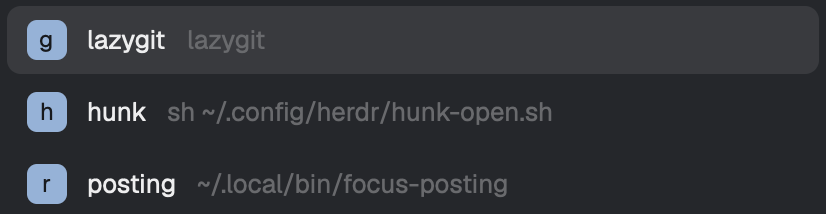

# herdr-popup-tools

One key opens a small picker of your terminal tools in the [Herdr](https://herdr.dev)
desktop app. Pick one and it runs in a floating dialog covering 90% of the window,
in the focused pane's folder. When the program exits, the dialog closes. Press the
key again, Esc, or click outside to close the dialog early, which ends the program.



Unlike [Nico-Mayer/lazygit-herdr](https://github.com/Nico-Mayer/lazygit-herdr), it runs any
command, starts a fresh run each time, and closes the dialog when the program exits.

## Use

- `ctrl-alt-t` opens the picker.
- Type a tool's key letter to launch it, or use Up/Down and Enter, or click a row. Esc closes the picker.
- With a tool dialog open, `ctrl-alt-t` closes it instead.

## Install

Ask your Herdr agent:

> Read ~/.config/herdr-app/AGENTS.md, then add this mod: https://github.com/ernestjsf/herdr-popup-tools

Or copy `mods/popup-tools/` into `~/.config/herdr-app/mods/`, merge `keys.json` into
yours, and run `herdr-app check ~/.config/herdr-app/mods/popup-tools`.

## Config

`~/.config/herdr-app/popup-tools.json`:

```json
{
  "tools": [
    { "key": "g", "name": "lazygit", "command": "lazygit" },
    { "key": "h", "name": "htop", "command": "htop", "size": 0.75 }
  ]
}
```

- `key`: one character, unique.
- `name`: shown in the picker.
- `command`: run through your login shell (`$SHELL -lc "exec <command>"`), so your `PATH` and `~` work. It must be one program with arguments. Put `cd x && tool` or `VAR=1 tool` in a script.
- `size`: optional, the share of the window for both width and height. Default `0.9`.

Without the file you get one tool, lazygit on `g`. A broken file shows an error
toast naming the problem, and the picker closes. Edits apply on the next press.

## Open a tool from another mod

Set a shared request, then open the mod. It launches that tool directly, without
the picker:

```js
setShared("popup-tools.request", { tool: "lazygit" }); // a name or a key
run("mod.open", { name: "popup-tools" });
```

An unknown tool shows an error toast.

## What it runs

`hc run` for each tool, labelled `herdr.mod=popup-tools` and `popup-tools.tool=<name>`,
and `terminal.kill` when you close the dialog early. It reads only its config file.
It never reaches the network.

## Development

```sh
npm test       # node --test
npm run check  # herdr-app check mods/popup-tools
```

Stdlib only. Symlinking `mods/popup-tools` into Herdr does not always hot-reload on
edits. If it doesn't, remove and recreate the link.

## License

MIT.
