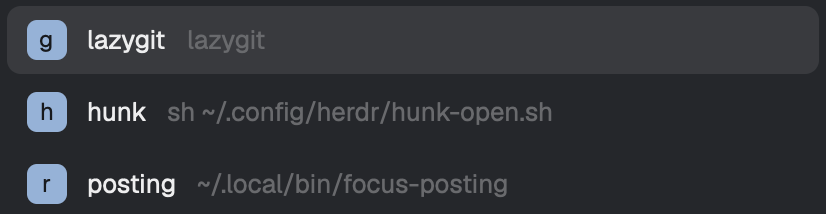

# Popup tools

One key (`ctrl-alt-t`) opens a small centered picker of terminal tools: a row
per tool with its key letter, name and command. Typing a key letter runs that
tool at once in a dialog covering 90% of the window, started in the focused
pane's folder. When the program quits, the dialog goes away. Pressing the key
again, Esc, or a click outside closes the dialog and ends the program, and the
pane that had focus gets it back.

## What you see

**The picker**, a Herdr dialog 420px wide whose height fits its rows, centered. Inside, `popover` background, 6px padding, 2px between
rows, 13px text in `foreground`. Each row is 34px tall, 10px side padding,
10px gaps, radius 7, left to right:

- the key letter in a 20px square badge, radius 5, `accent` background,
  `accent_foreground` 12px semibold text, centered;
- the tool's name;
- the command in `dim`, filling the rest and truncated.

The selected row (the first at open) has a `selected` background. A hovered
row has `hover`. No header, no footer.

**The tool dialog**, a Herdr dialog sized to the tool's `size` share of the
window in both directions (0.9 by default). It shows only the program's
terminal.

**Errors** come as Herdr's error toasts titled `popup-tools`, for example
`popup-tools.json: tool 1 (a): missing "command"` or
`no tool "nope" in popup-tools.json`.

## How it behaves

- It shows no agent status. Working, blocked, done and idle agents look the
  same to it, and a tool's terminal is not an agent.
- `ctrl-alt-t` (`mod.open:popup-tools`) opens the picker with the keyboard on it.
- A key letter without ctrl, alt or cmd launches that tool. Up and Down move
  the selection and wrap. Enter launches the selected row. A click launches
  its row. Esc closes the picker.
- Launching starts the program in the focused pane's live folder, closes the
  picker and opens the tool dialog with the terminal focused.
- With a tool dialog open, `ctrl-alt-t` closes the dialog and shows no picker.
- Closing the tool dialog in any way kills the program if it is still running
  and focuses the pane that had focus before.
- When the program exits on its own, its terminal is removed and the dialog
  closes. The next press shows the picker again.
- Another mod can skip the picker by setting
  `setShared("popup-tools.request", { tool })` (a name or a key) and running
  `mod.open {name: "popup-tools"}`. The request is cleared and that tool is
  launched. An unknown tool shows an error toast.
- The config file is read on every open, so edits apply on the next press.
- A broken config file shows its error toast and closes the picker.

## Built from

One mod, `mods/popup-tools/`, plus a `keys.json` with
`{"global": {"ctrl-alt-t": "mod.open:popup-tools"}}`. No layout.

- `mod.json`: `{"place": "none", "title": "Popup tools", "overlay": {"kind": "dialog", "width": 420}}`.
  Leaving out `height` makes the dialog fit its content.
- `tools.js`, pure and tested with `node:test`:
  - `parseConfig(text)` takes `~/.config/herdr-app/popup-tools.json`'s text (null
    when missing) and returns `{tools}` or `{error}`. The format is
    `{"tools": [{"key", "name", "command", "size"?}]}`. `key` is one character
    and unique, `name` and `command` are non-empty, `size` is above 0 and up to
    1, defaulting to 0.9. A missing file gives `[{key: "g", name: "lazygit", command: "lazygit"}]`.
    Invalid JSON, a non-list or empty `tools`, and each bad entry give an
    error naming the entry (`tool 2 (gitui): key "g" is already used`).
  - `findTool(tools, query)` finds by name, then by key.
  - `hcRunArgs(tool, cwd)` builds the launch line.
- `main.js`, one `View` with two roles from `props().role`:
  - **Picker** (no role, opened by `mod.open`). `init` makes a focus handle,
    focuses it, and focuses it again after 600ms, as the shipped picker does.
    It reads the config with `readTextFile(appHome() + "/popup-tools.json")`.
    If a tool dialog is open (its overlay id is kept in `globalThis`), it
    closes that and itself. If `shared("popup-tools.request")` is set, it
    clears it with `setShared(…, null)`, launches, and closes itself. In those
    two cases it renders an empty root. Otherwise it renders the rows, with
    `track_focus` and `on_key_down` on the root (`e.key_char` for letters,
    `e.key` for up, down, enter and escape).
    `init` also keeps `focused()` as the origin, before the picker takes the
    keyboard. A picked tool uses the origin's `cwd` and `pane`. A requested
    tool reads `focused()` at launch.
  - **Launch**: `hc(["run", "--json", "--bg", "--rm", "--no-parent", "--cwd", origin.cwd, "--label", "herdr.mod=popup-tools", "--label", "popup-tools.tool=<name>", "--", "/bin/sh", "-c", 'exec "${SHELL:-/bin/sh}" -lc "$1"', "sh", "exec <command>"])`,
    then `closeOverlay(picker)`, then
    `openOverlay({kind: "dialog", width: size, height: size, layout: {type: "column", children: [{type: "block", size: {px: 0}, content: {mod: "popup-tools", props: {role: "sentinel", terminal, previousPane}}}, {type: "block", content: {terminal}}]}})`.
  - **Sentinel** (the 0px block). `render` closes its overlay once its terminal
    has been seen in `terminals()` and is now gone. `close()` forgets the
    dialog id, runs `terminal.kill` if the terminal is still alive, and runs
    `pane.focus {pane: previousPane}`.
- Programs it runs: `hc run` and, through it, the login shell (`$SHELL -lc`). Herdr commands:
  `terminal.kill`, `pane.focus`. No art.

## Watch out

- `terminals()` lags behind `hc run`. A sentinel that closes as soon as its
  terminal is missing closes the dialog at once and orphans the program. Wait
  until it has been seen alive once.
- The picker's `init` can run twice for one overlay. Guard the side effects
  (toggle-close, request launch) with the overlay id in `globalThis` memory,
  and clear the guard when the work finishes, since overlay ids are reused.
  Don't return early from the whole `init`, or the copy that stays has no rows.
- A picked tool uses the `focused()` read in the picker's `init`, not one read
  at launch.
- The command runs as `exec <command>`, so it must be one program with
  arguments. `FOO=1 tool` exits 127, and `cd ~/x && tool` exits at once
  without running `tool`. Put compound commands in a script.
- A request set while a tool dialog is open is not cleared. That press only
  closes the dialog, and the next plain press launches the requested tool
  with no picker.
- `globalThis` survives hot reload. Use a versioned key (`__popup_tools_v1`).
- A mod can't import files outside its own folder, even through a symlink.
- A dialog's tasks end when it closes. Close the picker after the last `await`
  in the launch, right before `openOverlay`.
- Launch through the login shell (`$SHELL -lc "exec …"`), or `~` and login `PATH` tools won't resolve.
- With a tool open, the key briefly opens an empty picker dialog that closes
  itself. Tasks need a live overlay, so the picker can't be skipped.
- Assumes macOS or Linux (`/bin/sh` and `$SHELL`), `hc` on the app's path,
  and `lazygit` installed for the default tool.
- `mod.open` while a tool dialog is open ends that program. Scripts that open
  the picker should check `herdr-app status` for a `layout` overlay first.

## Done when

- `npm test` passes: a missing file gives the lazygit default; sizes default
  to 0.9; bad JSON, a non-list or empty `tools`, a duplicate key, a missing
  command, a bad key, name or size each give their error; `findTool` matches a
  name before a key; `hcRunArgs` gives the exact line, with no `--cwd` when
  the folder is unknown.
- `herdr-app check mods/popup-tools` passes.
- `herdr-app do mod.open --name popup-tools` shows `"overlays": ["popup-tools"]`
  in `herdr-app status`, and `hc ls --json --label herdr.mod=popup-tools`
  lists no terminal.
- A launch (a key letter, or a request from another mod) leaves exactly one
  terminal in that list, with labels `herdr.mod=popup-tools` and
  `popup-tools.tool=<name>`, argv `/bin/sh -c 'exec "${SHELL:-/bin/sh}" -lc "$1"' sh "exec <command>"`, and the
  focused pane's folder as cwd. The status shows a `layout` overlay.
- `mod.open` again empties both the overlays and the terminal list.
- Killing the program's pid (`hc get <t> --json`) empties both too, and the
  next `mod.open` shows the picker.
- A config entry without `command` toasts `popup-tools.json: tool 1 (…): missing "command"`.
- `herdr-app status` shows `"errors": []` throughout.
